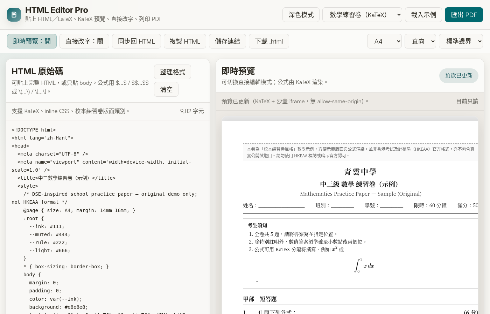

# HTML Editor Pro

[](https://kyleyct.github.io/html-editor-pro/)
[](./LICENSE)
[](https://katex.org/)

給香港老師用的純前端 HTML 試卷／教材編輯器：將學校 LLM 產出的 HTML／LaTeX 貼入、即時預覽、直接改字、用 KaTeX 顯示公式，再以瀏覽器列印成 PDF。資料不經伺服器。

**EN:** Paste LLM-generated HTML + LaTeX, live-preview with KaTeX, edit text in place, print to PDF — static, no backend. Built for Hong Kong classroom workflows.

**Live demo:** https://kyleyct.github.io/html-editor-pro/



## 適合哪些人／Who it’s for

- 使用學校 LLM／AI 平台產出試卷、工作紙、通告的老師
- 需要快速預覽 HTML、改字、輸出 A4 PDF 的教育工作者
- 想在瀏覽器內顯示 LaTeX 公式，而不想安裝 TeX 發行版的人

## 功能／Features

- HTML 原始碼編輯 + iframe 即時預覽（約 260 ms debounce）
- 預覽區「直接改字」→ 以 `postMessage` 同步回 HTML（沙盒已移除 `allow-same-origin`）
- **KaTeX** 自動渲染：`$...$`、`$$...$$`、`\(...\)`、`\[...\]`
- 校本練習卷風格 CSS 示例（A4、題號、分數、作答線）
- 儲存分享連結（`lz-string` 壓縮到 `?c=`）或下載 `.html`
- 瀏覽器列印 → PDF（紙張／方向／邊界）
- 深色／淺色模式；草稿存 `localStorage`

## LLM 工作流程／School LLM workflow

1. 在學校 LLM 用系統提示要求輸出 **完整 HTML**，公式用 KaTeX 分隔符。
2. 將輸出貼入左邊「HTML 原始碼」。
3. 右邊即時預覽；需要改字就開「直接改字」，再按「同步回 HTML」。
4. 選 A4 →「匯出 PDF」→ 瀏覽器列印對話框另存 PDF。
5. （可選）「儲存連結」分享；內容大就改用「下載 .html」。

可參考 [`prompts/exam-paper-zh.md`](./prompts/exam-paper-zh.md) 作為系統提示草稿。

### KaTeX 分隔符（請寫入 LLM 提示）

| 類型 | 分隔符 |
|------|--------|
| 行內 | `$...$` 或 `\(...\)` |
| 獨立一行 | `$$...$$` 或 `\[...\]` |

## 示例／Demos

| 示例 | 說明 |
|------|------|
| **數學練習卷（KaTeX）** | 虛構「青雲中學」中三練習卷：分數、方程、直線、統計圖（SVG）、簡易微積分；全部為原創示例題 |
| **活動海報** | 一般 HTML／PDF 流程示範 |

## 分享／Sharing

- 「儲存連結」用 [lz-string](https://github.com/pieroxy/lz-string) 把內容壓縮進 URL 的 `?c=`。
- 原始內容上限約 200 KB；壓縮後參數建議 ≤ 6,000 字元（過長請下載檔案）。
- **無後端**：內容只在瀏覽器及 URL，不會上傳到伺服器。

## 安全／Security

- 預覽 iframe sandbox：`allow-scripts allow-modals allow-downloads allow-popups`（**無** `allow-same-origin`），降低惡意分享頁讀取父頁 `localStorage` 的風險。
- 直接改字／同步改用 `postMessage`，不再依賴同源存取。
- **請只開啟你信任的分享連結**；別人的 HTML 仍可在 iframe 內執行 script。

## 限制／Limitations

- PDF 依賴瀏覽器「列印 → 另存 PDF」，不是伺服器產生的 PDF binary。
- KaTeX 支援常見中學數學；極冷門 TeX 宏可能要改寫。
- 「直接改字」模式會暫時不渲染公式，方便保留 `$...$` 原文；改完請同步後再開回一般預覽。
- 版面為 **校本練習卷風格／DSE-inspired**，**不是** HKEAA 官方格式。

## 免責聲明／Disclaimer

> 本工具提供「考試卷面風格」的版面參考，方便教學及練習卷製作。並非香港考試及評核局（HKEAA）官方格式，亦不包含真實公開試題目。請勿使用 HKEAA 標誌或暗示官方認可。

## 相關工具／Related

| 專案 | 用途 |
|------|------|
| [hk-exam-timer](https://github.com/kyleyct/hk-exam-timer) | 試場倒數計時 |
| [hkedu-python-compiler](https://github.com/kyleyct/hkedu-python-compiler) | 瀏覽器 Python（Pyodide），可產出圖表再貼回來 |
| [excel2md](https://github.com/kyleyct/excel2md) | 試算表 → Markdown |

## 本機開啟／Run locally

```bash
git clone https://github.com/kyleyct/html-editor-pro.git
cd html-editor-pro
python3 -m http.server 8080
# 開啟 http://localhost:8080/
```

## 技術／Tech

- 單頁靜態站：`index.html` + `favicon.svg`（GitHub Pages）
- CDN：KaTeX `0.16.11`、lz-string `1.5.0`
- 無後端、無建置步驟

## 授權／License

[MIT](./LICENSE) © 2026 Kyle Yeung（`kyleyct`）
